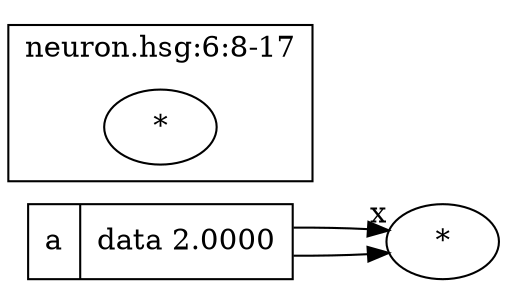
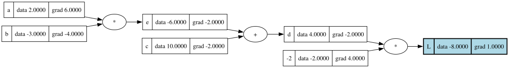
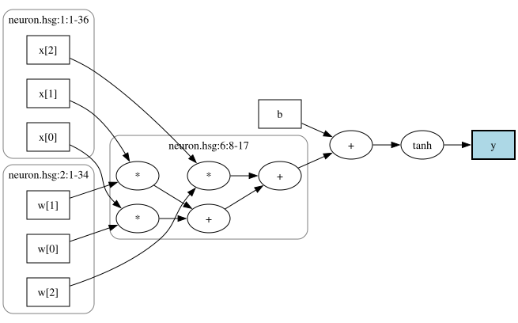
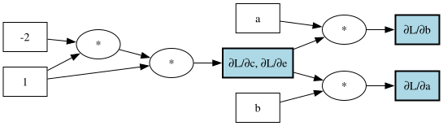

# 07 — `Viz.Dot`: drawing graphs with Graphviz

This step adds `HsGrad.Viz.Dot`, which turns a graph into a picture, or
rather into the text of one: source code in **DOT**, the language of
[Graphviz](https://graphviz.org). Running `dot -Tsvg` on that text lays out
the graph and draws it. The pictures look like the ones micrograd's
`draw_dot` makes:

- every value is a **box** with its name and, optionally, its forward value
  (step 4) and its gradient (step 5): `{ e | data -6.0000 | grad -2.0000 }`;
- every operation is a small **op node** (`*`, `+`, `tanh`, …) between its
  arguments and its result;
- edges follow the **data flow**, from the leaves to the outputs.

On top of micrograd's picture, the exporter can **highlight** output nodes
and caption them (`∂L/∂a`, for the gradient graphs of step 7), and
**cluster** nodes by the source expression they came from (provenance,
D4), so that the hundreds of scalar nodes an unrolled vector expression
produces are drawn as one framed group.

The module only produces `Text`. Writing files and running Graphviz is the
CLI's job (`hsgrad plot`, `hsgrad derive --dot`, step 15). It is the first
module outside Core: it depends on Core and nothing depends on it
(`00-architecture.md` §2).

---

## 1. Theory

### 1.1 Just enough DOT

DOT describes a graph as a list of statements. This is all the exporter
uses:



- **Node ids** (`n0`, `o3`) are names for the nodes inside the file. What is
  drawn is the `label`. Ids made of a letter and digits need no quoting.
- **Attributes** go in square brackets: `shape`, `label`, `style`,
  `fillcolor`, `penwidth` for nodes; `headlabel` for edges.
- A node is created by the first statement that mentions it, and it belongs
  to the subgraph where that happens. So the exporter declares every node
  first (inside its cluster, if it has one) and lists all edges at the end.
- A **subgraph** whose name starts with `cluster` is drawn as a frame around
  its nodes; any other subgraph is invisible.
- **`rankdir`** says which way the graph flows. Graphviz puts nodes in
  *ranks* (columns for `LR`, rows for `TB`) so that edges point one way.

**Records.** A node with `shape=record` is a box divided into *fields*.
The label `a | data 2.0000 | grad 6.0000` has three fields, separated by
`|`, laid out *across* the flow: stacked vertically in a left-to-right
graph. Braces flip the direction: `{ a | data 2.0000 | grad 6.0000 }` lays
the fields out side by side in a left-to-right graph. micrograd uses braces
for exactly this reason, and the exporter adds them only for `LR` (§3.4).

**Strings and escapes.** Labels are double-quoted strings, read by two
layers:

1. The DOT parser ends the string at an unescaped `"`, so a quote inside it
   is written `\"`.
2. Graphviz then interprets backslash sequences in labels: `\n` is a line
   break, `\N` the node's id, `\G` the graph's name, `\\` a backslash. So a
   backslash meant literally must be doubled, or `a\Nb` would print the
   node id in the middle.
3. In a **record** label, `{`, `}`, `|`, `<` and `>` structure the fields
   (`<p>` names a port). To stand for themselves, they are written `\{`,
   `\}`, `\|`, `\<`, `\>`.

A leaf named `W1[3,0]` needs no escaping, but the exporter can't know what
names and labels the compiler will produce, so it escapes everything, every
time (§3.6).

### 1.2 micrograd's `draw_dot`

micrograd draws its graphs with the `graphviz` Python package:

```python
def draw_dot(root, format='svg', rankdir='LR'):
    nodes, edges = trace(root)
    dot = Digraph(format=format, graph_attr={'rankdir': rankdir})
    for n in nodes:
        dot.node(name=str(id(n)),
                 label="{ %s | data %.4f | grad %.4f }" % (n.label, n.data, n.grad),
                 shape='record')
        if n._op:
            dot.node(name=str(id(n)) + n._op, label=n._op)
            dot.edge(str(id(n)) + n._op, str(id(n)))
    for n1, n2 in edges:
        dot.edge(str(id(n1)), str(id(n2)) + n2._op)
    return dot
```

`trace` collects every `Value` the root depends on. Each value becomes a
record, and each value that an operation produced gets a second node for the
op, with an edge from the op to the value. The edges of the graph run from
each argument into the op node of the value that uses it.

For `intro.hsg` (`01-language.md` §1.1) after `L.backward()`, the exporter
draws the same picture:



Every number in it is from earlier steps: the values from `Core.Eval`
(`d = 4`, `L = -8`), the gradients from `Core.Backprop` (`∂L/∂a = 6`, and
`∂L/∂L = 1` at the highlighted output).

### 1.3 Pictures of unrolled graphs

micrograd's graphs only ever come from small scalar expressions. Ours also
come from `.hsg` programs with vectors and matrices, which the compiler
unrolls into scalar nodes (D5): `dot(w, x)` with `Vec 3` arguments becomes
three multiplications and two additions. A drawing of every scalar node is
accurate, but it loses the structure of the source: which of the hundreds
of `*` nodes belong to `W1 @ x`, and which to `W2 @ h1`?

That structure is still in the graph, as **provenance** (D4): every node
records the span of the source expression that created it. Nodes that share
a span came from one expression, so the exporter can draw them inside one
frame, labelled with the span. Here is `neuron.hsg` (`01-language.md` §1.2):



The three leaves `x[0]`, `x[1]`, `x[2]` came from one declaration
(`input x : Vec 3 = …` at line 1), and so did the `w`s; the five unnamed
nodes in the middle are `dot(w, x)` in the body of `neuron` (line 6,
columns 8–16). The `+ b`, the `tanh` and `b` are single nodes with spans of
their own, so they need no frame (§4.6).

### 1.4 Pictures of gradient graphs

Step 7 will compute gradients *as graphs*: `∂L/∂a` becomes a node whose
value is the gradient, built from the same op set and sharing nodes with
the forward graph (D6). Those graphs are ordinary `Graph`s, so they need
nothing new, with one exception. Their important nodes have no names: the
node that *is* `∂L/∂a` is just some `*`. The exporter therefore accepts
**captions** for highlighted nodes. Here is a hand-built sketch of what
step 7 will produce for `intro.hsg` (`∂L/∂c` and `∂L/∂e` are the same
node, so it gets both captions):



After the simplifier of step 8, the `1 · -2 · 1` chain on the left will
fold into the constant `-2`.

## 2. From micrograd to hsgrad

| micrograd | hsgrad |
|---|---|
| the `graphviz` Python package | a hand-written DOT writer (`00-architecture.md` §8) |
| `trace(root)`: depth-first search for the nodes | `reachable g outs` (step 3), or every node of the graph |
| `id(n)` as the node's DOT name | `n7` / `o7`: the node's index, prefixed |
| `n.data`, `n.grad`, always shown | `dotValues`, `dotGrads`: optional maps, shown when given |
| `n.label`, set by hand | the leaf's name, or the node's provenance label |
| one picture per root | any set of outputs, each optionally highlighted and captioned |
| — | clusters by source span (D4) |
| returns a `Digraph` object | returns `Text` |

## 3. Code walkthrough

The module lives at `src/HsGrad/Viz/Dot.hs`.

### 3.1 Options

```haskell
data DotOptions = DotOptions
  { dotValues :: !(Maybe Values)
  , dotGrads :: !(Maybe Grads)
  , dotHighlights :: ![Highlight]
  , dotClusters :: !Bool
  , dotRankDir :: !RankDir
  }

data RankDir = LeftToRight | TopToBottom

defaultDotOptions :: DotOptions   -- names only, left to right
```

Everything the picture can show is chosen here. Values and gradients are
the maps the earlier steps return (`Values` from `Core.Eval`, `Grads` from
`Core.Backprop`), so "include values" means "here are the values". A
typical call starts from the defaults and changes a few fields:

```haskell
case gradients g env loss of
  Right (vals, grads) ->
    renderDotFrom
      defaultDotOptions {dotValues = Just vals, dotGrads = Just grads, dotHighlights = [highlight loss]}
      g
      [loss]
```

### 3.2 Highlights

```haskell
data Highlight = Highlight
  { hlNode :: !NodeId
  , hlCaption :: !(Maybe Text)
  }

highlight   :: NodeId -> Highlight            -- no caption
highlightAs :: Text -> NodeId -> Highlight    -- highlightAs "∂L/∂a" i
```

A highlighted node is drawn filled and with a thicker border. Its captions,
if any, are the first field of its box; several highlights of one node
contribute all their captions, in order, separated by commas. A highlight
of a node that is not drawn is ignored.

### 3.3 Rendering

```haskell
renderDot     :: DotOptions -> Graph -> Text              -- every node
renderDotFrom :: DotOptions -> Graph -> [NodeId] -> Text  -- what the outputs depend on

render :: DotOptions -> [(NodeId, Node)] -> Text
render opts ns =
  Text.unlines $
    ["digraph hsgrad {", "  rankdir=" <> rankDir <> ";"]
      ++ concatMap (indent . nodeStatements opts) loose
      ++ concat (zipWith (cluster opts) [0 ..] (Map.toList clustered))
      ++ concatMap (indent . edgeStatements opts valueIdOf) ns
      ++ ["}"]
  where
    valueIds = IntMap.fromList [(nodeIndex i, valueId opts i n) | (i, n) <- ns]
    valueIdOf a = valueIds IntMap.! nodeIndex a
    ...
```

Both entry points hand `render` a list of nodes in ascending id order: all
of them, or the reachable ones. Either list is **closed under arguments**:
every argument of a node in it is in it too. That is what makes
`valueIds IntMap.! …` safe, and it means no edge can point at a node that
was not declared (a property test checks this, §5).

The output is assembled from lists of lines: the header, the declarations
of the nodes outside any cluster, one subgraph per cluster, then every
edge. `Text.unlines` joins them once at the end, so the cost is linear in
the size of the output.

### 3.4 Boxes and op nodes

Every graph node `i` can have a box `n<i>` and an op node `o<i>`. Using the
node index in the DOT id makes ids unique and stable, and lets a reader
match a picture with test output or an error message that names a
`NodeId`.

```haskell
boxFields :: DotOptions -> NodeId -> Node -> [Text]
boxFields opts i n =
  concat
    [ [Text.intercalate ", " cs | let cs = captions opts i, not (null cs)]
    , maybe [] pure (nodeName n)
    , ["data " <> showNumber v | Just vals <- [dotValues opts], Just v <- [lookupValue i vals]]
    , ["grad " <> showNumber d | Just grads <- [dotGrads opts], Just d <- [lookupGrad i grads]]
    ]
```

A box has up to four fields: captions, name, value, gradient. Each is there
only if the node has one; the list comprehensions with
`Just x <- [lookup …]` are the bind-and-filter idiom from
`docs/06-core-backprop.md` §3.5. A node without a gradient (the output
does not depend on it) shows no `grad` field, rather than `grad 0.0000`,
following `docs/06-core-backprop.md` §4.3.

The **name** depends on the kind of node:

```haskell
nodeName :: Node -> Maybe Text
nodeName n = case nodeOp n of
  Leaf (Input (Name x)) -> Just x
  Leaf (Param (Name x)) -> Just x
  Leaf (Const c) -> Just (maybe "" (<> " = ") lbl <> showConst c)
  _ -> lbl
  where
    lbl = provLabel (nodeProv n)
```

Inputs and parameters show their name, which is how `--set` and parameter
files refer to them. Constants show their number (`-2`), so it is visible
even without values, and their label in front if they have one
(`f = -2`). Other nodes show their label (`e`, `L`), if any.

**No fields, no box.** If a node has nothing to show (an unnamed interior
node, no values, no caption), it gets no box at all: its op node stands for
its value, and edges to its users start there.

```haskell
valueId :: DotOptions -> NodeId -> Node -> Text
valueId opts i n
  | hasBox opts i n = boxId i
  | otherwise = opId i
```

This is what makes the `dot(w, x)` cluster of §1.3 a chain of `*` and `+`
nodes instead of five empty boxes. Leaves always have a name, so they
always have a box. §4.3 discusses this choice.

`nodeStatements` writes the declarations. The record label gets braces
only for `LR`, so that the fields are side by side in both directions
(§1.1):

```haskell
    recordLabel fs = case dotRankDir opts of
      LeftToRight -> "{ " <> body <> " }"
      TopToBottom -> body
      where
        body = Text.intercalate " | " (map escapeRecordField fs)
```

The **op labels** are `+ - * /` for the binary ops, and `neg`, `^2`,
`^-1`, `^(1/2)`, `exp`, `log`, `tanh`, `relu`, `step` for the unary ones.
`neg` is spelled out so it can't be confused with subtraction.

A highlight puts `style=filled, fillcolor=lightblue, penwidth=2` on the
box, or on the op node if there is no box.

### 3.5 Edges

```haskell
edgeStatements :: DotOptions -> (NodeId -> Text) -> (NodeId, Node) -> [Text]
edgeStatements opts valueIdOf (i, n) = case opLabel (nodeOp n) of
  Nothing -> []
  Just _ -> zipWith argEdge argNames (nodeArgs n) ++ outEdge
  where
    argEdge name a =
      valueIdOf a <> " -> " <> opId i <> maybe "" (\l -> " [headlabel=" <> quoted l <> "]") name <> ";"
    outEdge = [opId i <> " -> " <> boxId i <> ";" | hasBox opts i n]
    argNames = case nodeOp n of
      Bin Sub -> [Just "x", Just "y"]
      Bin Div -> [Just "x", Just "y"]
      _ -> repeat Nothing
```

One edge per argument *position*, so `a + a` (one `Add` node with
arguments `[a, a]`, D3) gets two parallel edges, just as backprop gets two
contributions (`docs/06-core-backprop.md` §1.2). For `-` and `/` the order
of the arguments matters, and a picture can't show order on its own:
Graphviz places nodes wherever the layout is best. So their edges carry
small labels `x` and `y` at the op node, the names `docs/03-core-op.md`
uses for the first and second argument.

### 3.6 Escaping

```haskell
escapeString :: Text -> Text          -- for "…" strings
escapeString = Text.concatMap escapeChar

escapeRecordField :: Text -> Text     -- for one field of a record label
escapeRecordField = Text.concatMap esc
  where
    esc c
      | c `elem` ("{}|<>" :: String) = Text.pack ['\\', c]
      | otherwise = escapeChar c

escapeChar :: Char -> Text
escapeChar c = case c of
  '"' -> "\\\""
  '\\' -> "\\\\"
  '\n' -> "\\n"
  _
    | isControl c -> " "
    | otherwise -> Text.singleton c
```

These are the rules of §1.1: quotes and backslashes for every string, the
structure characters for record fields. A line break in a label becomes
`\n`, a centred line break; other control characters become spaces.
Everything else passes through, including UTF-8: Graphviz reads DOT files
as UTF-8 by default, so `∂L/∂a` needs no escaping.

Every label goes through one of the two functions: names, captions and
values through `escapeRecordField`, op labels and cluster captions (which
contain file names) through `escapeString`. Both are exported, so the tests
can check them directly.

### 3.7 Clusters

```haskell
clusters :: [(NodeId, Node)] -> ([(NodeId, Node)], Map SrcSpan [(NodeId, Node)])
clusters ns = (filter (not . inCluster) ns, groups)
  where
    bySpan =
      Map.fromListWith
        (flip (++))
        [(sp, [(i, n)]) | (i, n) <- ns, Just sp <- [provSpan (nodeProv n)]]
    groups = Map.filter ((>= 2) . length) bySpan
    inCluster (_, n) = maybe False (`Map.member` groups) (provSpan (nodeProv n))
```

The nodes are grouped by their exact span. `Map.fromListWith (flip (++))`
collects each span's nodes; `flip` keeps them in ascending order (the
combining function receives the *new* element first). Only spans with at
least two nodes become clusters (§4.6); everything else, including every
node without a span, stays outside.

Each cluster becomes a `subgraph cluster_<k>` with the span as its label,
in the form `file:line:col-col` (`file:line:col-line:col` across lines,
end column exclusive as in `SrcSpan`). Clusters come out in the order of
their spans (file, then start, then end), so the output is deterministic.

### 3.8 Numbers

```haskell
showNumber :: Double -> Text
showNumber x
  | x == 0 = "0.0000" -- also for -0.0
  | a >= 1e-3 && a < 1e6 = Text.pack (showFFloat (Just 4) x "")
  | otherwise = Text.pack (showEFloat (Just 4) x "")
```

Values and gradients use micrograd's `%.4f`, except for very small and
very large magnitudes: `1e-7` would print as `0.0000`, which looks like a
zero gradient, and `1e200` would print as 201 digits. Those switch to
scientific notation, `1.0000e-7`. Negative zero prints as `0.0000`.

Constants in names are printed as a programmer would write them: `-2`, not
`-2.0`, for whole numbers, and Haskell's `show` otherwise (`0.5`,
`1.0e-4`).

## 4. Design decisions

### 4.1 A hand-written writer that returns `Text`

`00-architecture.md` §8 keeps the dependencies small, and the subset of DOT
needed here fits on a screen (§1.1): one more package would buy little. The
writer returns `Text` instead of writing a file, so the module stays pure.
The CLI decides where the text goes (`--dot OUT`), and the tests compare
the text directly.

### 4.2 Values and gradients are data in the options

The options hold `Maybe Values` and `Maybe Grads` instead of flags like
"show values". The exporter never evaluates anything, so it can't fail
and doesn't need an `Env`. The caller already has the maps, and any maps
will do: values from one training step, gradients of a different output,
or none.

### 4.3 A box only when it has something to show

micrograd draws a record for every value, and with values and gradients
switched on, so does this exporter: every node has a `data` field. Without
them, an unnamed interior node would get an empty box, and a gradient graph
consists mostly of such nodes: each `*` would be followed by an empty
rectangle. Dropping empty boxes keeps the picture an expression tree (op
nodes between named values), and costs one rule: an edge to a user starts
at the node's box if it has one, otherwise at its op node (`valueId`).

The alternative, putting the op into the box (`{ * | e | data -6 }`),
would make every node a single DOT node, but then a picture with values
looks nothing like micrograd's, and the op of a named node would compete
with its name for attention.

### 4.4 Labels on the arguments of `-` and `/` only

Graphviz chooses where arguments go, so `a - b` and `b - a` may look the
same. Labelling the edges is the simplest unambiguous fix. Only the two
non-commutative binary ops get labels; on `+` and `*` they would be
clutter, and unary ops have one argument.

### 4.5 Highlights carry captions

The gradient graphs of step 7 are why highlights exist. Their outputs are
nodes like `-2 · b`, which have no label, and two gradients may be the same
node after hash-consing. Captions solve both: the caller names each output
(`∂L/∂a`), the box shows every name the node has, and nothing in the graph
has to change. The forward picture uses the same mechanism without a
caption (`highlight loss`), since the loss already has a label.

An alternative was to put the caption into the graph as a label. But a
graph is shared (the gradient graph *contains* the forward graph), labels
are "first wins" (step 3), and the same node may be `∂L/∂c` in one picture
and something else in another. A caption is a property of a picture, so it
belongs in the options.

### 4.6 Flat clusters by exact span, two nodes at least

Spans nest: in `tanh(dot(w, x) + b)` the span of `dot(w, x)` lies inside
the span of the `+`, which lies inside the span of the `tanh`. Nested
clusters would mirror that, but inlined function bodies break the nesting.
The nodes of `neuron`'s body have spans in the *body*, not inside the span
of the call `neuron(w, b, x)`, and two calls of one function share the same
body spans (a test checks that those nodes land in one cluster). Exact-span
clusters are predictable: one frame per source expression, whatever calls
it.

A frame around a single node draws a box and a caption but groups nothing.
In `intro.hsg` every expression is one scalar node, so clustering it changes
nothing, which is the honest answer: nothing was unrolled. Clusters appear
exactly where unrolling happened (vector declarations, `dot`, `@`, `sum`,
comprehensions over datasets).

Labels play no part in clustering: they name single scalars (`W1[3,0]`),
while the span of `param W1` already groups all of them. A graph without
provenance (the random graphs of the tests, anything built by hand) simply
has no clusters; a property test checks that turning clustering on then
changes nothing.

### 4.7 Deterministic output

The same graph and options always give the same text, byte for byte: nodes
in id order, clusters in span order, edges in node order and then argument
order. This is what makes golden tests possible, and it keeps the files the
CLI writes diffable.

### 4.8 Highlights are a list

`captions` and `isHighlighted` scan the highlight list for every node, so
rendering costs `O(nodes × highlights)`. A map would be faster, but
Graphviz can't lay out more than a few thousand nodes in reasonable time
anyway, and a gradient picture has one highlight per `--wrt` leaf. The list
keeps the options easy to write.

## 5. Tests

`test/HsGrad/Viz/DotSpec.hs` has seven groups:

- **Golden tests**: the exact DOT text of `intro.hsg` with values,
  gradients and `L` highlighted (the picture in §1.2), of `intro.hsg` with
  names only, and of `neuron.hsg` with clusters (§1.3).
- **Boxes, op nodes and edges**: unnamed nodes are op nodes only, unless
  values are shown; constants show their number, labelled ones
  `f = -2`; every op's label; `x`/`y` on the edges of `-` and `/`, also for
  `a / a`; two edges for `a + a`; `renderDotFrom` draws only what the
  outputs depend on; no `grad` field for nodes the output does not depend
  on; number formatting, including `-0.0`, `1e-7` and `-1.5e200`;
  top-to-bottom layout without braces.
- **Highlights**: the gradient sketch of §1.4 (captions, a shared node with
  two captions, only the forward leaves it uses are drawn); a caption in
  front of a label; emphasis on the op node of a node without a box;
  highlights of nodes that are not drawn are ignored.
- **Escaping**: `escapeString` and `escapeRecordField` on quotes,
  backslashes (`\N` must not become a node id), line breaks, control
  characters, record structure characters and UTF-8; and in the output, a
  leaf named `say "hi" {x|y} <z> a\b`, a two-line label and a file name
  with quotes and a backslash.
- **Clusters**: none for spans of one node (`intro.hsg`); none without
  provenance (a property over random graphs); nodes without a span stay
  outside; nodes of two expressions with the same span share a cluster.
- **Random graphs**: for step 3's random graphs and random outputs, every
  DOT node is declared exactly once, every edge connects declared nodes,
  and the counts are right: with names only, one box per leaf, one op node
  per interior node and one edge per argument; with values (and
  clustering on), one box per node and one more edge per interior node.
- **Graphviz**: if `dot` is on the `PATH`, it accepts every example and 30
  random graphs with exit code 0 and **nothing on stderr**, so warnings fail
  the test too; and it shows the awkward label literally (checked in the
  SVG it produces). The test suite must not require Graphviz: without it,
  these three tests are reported as *pending*, not failed.

A golden test pins the output down completely, so it fails on any change,
wanted or not. When the format changes on purpose, the new text should be
read line by line (and rendered once) before it replaces the old one.

`HsGrad.Test.Examples` (new, in `test/`) builds `intro.hsg` and
`neuron.hsg` the way the compiler will (step 14): leaves with the span of
their declaration, expressions with their own spans, `let` results
labelled. Step 7 can use `intro` for its symbolic gradients, and step 14
can compare its compiled graphs against these.

The Graphviz tests write the DOT text to `dot`'s stdin as UTF-8 whatever
the system locale is (`setLocaleEncoding utf8`), since the gradient example
contains `∂`. They need two new test-suite dependencies, `process` (to run
`dot`) and `directory` (`findExecutable`), plus `text`, which the specs now
use directly. All three are boot packages.

### 5.1 Testing the tests

As in the earlier steps, deliberate bugs in `Dot.hs` each make tests fail:

| Bug | Failing tests |
|---|---|
| record structure characters not escaped | 4 |
| backslashes not doubled | 4 |
| edges from op node to argument (reversed data flow) | 6 |
| edges always start at the box, even when there is none | 3 |
| clusters also for single-node spans | 3 |
| no `x`/`y` labels on `-` | 1 |

The fourth bug produces edges to boxes that are never declared. Graphviz
accepts that silently (it creates the missing node), so only the golden
test and the structural property catch it, which is why the property
exists.

The full suite has 166 tests and takes about a second, most of it spent
running `dot`.

### 5.2 The pictures

The three SVGs in `docs/img/` are the DOT texts of the `intro` golden test,
the `neuron` golden test, and the gradient sketch, rendered with
`dot -Tsvg` (Graphviz 16.1). `.gitignore` ignores `*.svg` everywhere except
in `docs/img/`.

## 6. What later steps build on

- **Step 7 (`Core.Symbolic`)**: a gradient graph is drawn with
  `renderDotFrom opts g gradNodes`, with one `highlightAs "∂L/∂a" i` per
  `--wrt` leaf. Gradient nodes built under the forward node's span
  (`maybe id withSpan (provSpan p)`, step 3's hand-over) cluster together
  with the forward expression they differentiate. `HsGrad.Test.Examples.intro`
  is a ready-made forward graph for its tests.
- **Step 8 (`Core.Simplify`)**: simplified graphs are new graphs (a fresh
  `build`), so pass the simplified ids. The simplifier may drop spans and
  labels; the picture then simply has fewer names and clusters.
- **Step 14 (`Lang.Compile`)**: the clusters only appear if the compiler
  records spans as `HsGrad.Test.Examples` does (declaration spans on
  leaves, `withSpan` around each expression, `label` on `let` results).
  `nodeName` shows the *leaf name* of inputs and parameters, so their
  `Name`s should be what users type (`W1[3,0]`).
- **Step 15 (CLI)**: `hsgrad plot FILE --of L --dot OUT [--cluster]` is
  `renderDotFrom defaultDotOptions {dotClusters = c, dotHighlights =
  [highlight l]} g [l]`, plus values and gradients when the inputs have
  values. `hsgrad derive … --dot OUT` highlights the gradient nodes with
  captions. Write the text as UTF-8 (`Data.Text.IO.writeFile` uses the
  locale's encoding; use `Data.Text.Encoding.encodeUtf8` with a
  `ByteString` write, or set the handle's encoding). Rendering to SVG or
  PNG stays with the user: `dot -Tsvg OUT -o out.svg`.
