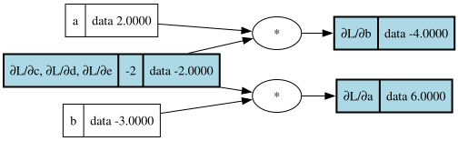
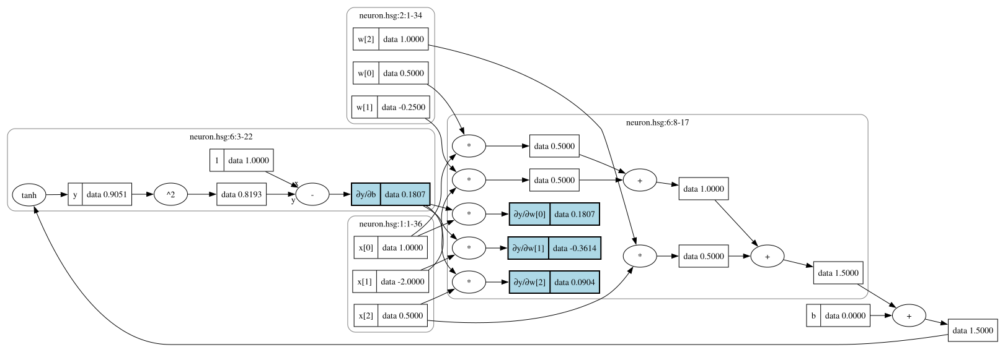

# 08 — `Core.Symbolic`: the gradient as a graph

This step adds `HsGrad.Core.Symbolic`, the second reverse sweep of D6.
`Core.Backprop` (step 5) computes `∂out/∂n` as **numbers**. This module
runs the same sweep, in the same order, with the same seed and the same
accumulation, but every step **emits graph nodes** into the `Builder`
instead of computing a number. The result maps every node the output
depends on to a node whose *value* is `∂out/∂n`:

```
backprop:  a ↦ 6.0                  (for a = 2, b = -3, c = 10)
symbolic:  a ↦ node 7 = f · b        (for any a, b, c)
```

The gradient nodes are added to the forward graph itself. They refer to
forward nodes (the rule for `tanh` uses the `tanh` node), and hash-consing
(D3) merges what different gradients have in common, so the gradient graph
is about as large as the forward graph and costs what one backprop sweep
costs. Because a gradient node is a node like any other, differentiating
it again gives **second derivatives** for free.

What can be done with the result: evaluate it with `Core.Eval` (this gives
backprop's numbers, exactly), draw it with `Viz.Dot`, simplify it
(step 8), print it (`hsgrad derive`, step 15).

---

## 1. Theory

### 1.1 The same sweep, with nodes for numbers

Backprop's loop (`docs/06-core-backprop.md` §1.3) is:

```
grad[out] = 1
for each reachable node n, in descending id order:
    for each argument position i of n:
        grad[argᵢ] += grad[n] · ∂n/∂argᵢ
```

Every operation in it is arithmetic on numbers: a constant `1`, the local
derivative `∂n/∂argᵢ` (a rule of step 2, evaluated), a product and a sum.
Each of them has a graph counterpart:

| backprop | symbolic |
|---|---|
| the seed `1` | the constant node `1` |
| `localGrads`: evaluate the rule with `evalDExpr` | `emitDExpr`: turn the rule into nodes (§3.3) |
| `grad[n] · local` | a `*` node with the gradient node and the local node as arguments |
| `+=` into the argument's entry | a `+` node of the old gradient node and the new contribution |
| `Grads = IntMap Double` | `GradNodes = Map NodeId NodeId` |

So `grad[a]` is no longer a number but the id of a node that *computes*
the number. Nothing else changes: same set of nodes, same order, same
handling of shared nodes, so every argument of step 5 (why descending ids,
why sums for shared nodes, why nodes outside the reachable set get
nothing) carries over unchanged.

For `intro.hsg` (`L = (a·b + c) · f` with the constant `f = -2`):

| Node | Rule | Gradient node |
|---|---|---|
| `L` | seed | the constant `1` |
| `d`, `f` | `L = d · f`: partials `f`, `d` | `1 · f` = **the node `f`**, `1 · d` = **the node `d`** |
| `e`, `c` | `d = e + c`: partials `1`, `1` | `f · 1` = `f`, both |
| `a`, `b` | `e = a · b`: partials `b`, `a` | **new** `f · b`, **new** `f · a` |

Multiplying by the literal `1` creates nothing (§1.5), so `∂L/∂d`, `∂L/∂e`
and `∂L/∂c` simply *are* the forward node `f`, and `∂L/∂f` is the node `d`.
The whole gradient adds three nodes to the graph: `f · b`, `f · a`, and the
constant `1` for `∂L/∂L`. Drawn with `Viz.Dot` and evaluated at the
defaults:



Step 6 drew a hand-made sketch of this graph (`docs/07-viz-dot.md` §1.4),
with a `1 · -2 · 1` chain it expected the simplifier to fold away. The
chain never appears: the literals of the seed and of `+`'s partials are
dropped as the sweep goes.

### 1.2 Gradients share the forward graph

The derivative rules of step 2 are written in terms of a node's arguments
(`DArg i`) and the node itself (`DOut`). The symbolic interpreter maps
both to **existing ids**, so the gradient nodes hang off the forward graph
instead of recomputing it. In the tanh neuron (`01-language.md` §1.2,
`y = tanh(dot(w, x) + b)`):

- the rule for `tanh` is `1 − y²`, with `y` the `tanh` node itself: one
  `^2`, one constant `1` and one `-` node, `t = 1 − y²`;
- `+` passes its gradient on unchanged, so `∂y/∂b` and the gradients of
  `dot(w, x)` and of every product inside it are all `t`;
- each product `w[i] · x[i]` gives `∂y/∂w[i] = t · x[i]` and
  `∂y/∂x[i] = t · w[i]`.

The 14 forward nodes get 9 gradient nodes: `y²`, `1`, `t`, and six
products. All six leaf gradients share `t`, and `t` shares `y`, which is
the whole forward graph:



The clusters (step 6) show where each gradient node came from: `t` was
created while differentiating the `tanh` (the span of `tanh(…)`), the three
products while differentiating `dot(w, x)` (§3.5). The highlighted boxes
are `∂y/∂w[0..2]` and `∂y/∂b`, with the gradient values at `neuronEnv`
(`w = [0.5, -0.25, 1]`, `b = 0`). The constant `1` of the `tanh` rule is
also `∂y/∂y`: hash-consing found the node that already existed.

### 1.3 Why this is not textbook symbolic differentiation

"Symbolic differentiation" usually means what a computer algebra system
or a calculus student does: take an **expression tree** and apply the
rules recursively, `(u·v)' = u'·v + u·v'`. Each rule copies its
subexpressions: `u` and `v` both appear in the result, and so do their
derivatives. In a tree every copy is a separate subtree, so nested
products make the result grow exponentially. This is known as
*expression swell*.

The chain of squarings shows how bad it gets:

```
x₀ = x,   xₖ₊₁ = xₖ · xₖ,   so x₃₀ = x^(2³⁰)
```

As a graph, `x₃₀` is 31 nodes. Written out as a tree, every use of `xₖ` is
a copy, and the expression already has `2³¹ − 1` (about two billion)
nodes before anything is differentiated. Its derivative, written out as a
tree, has about `1.5 · 10¹⁸` nodes.

`Core.Symbolic` never writes anything out. It is reverse-mode automatic
differentiation whose "numbers" happen to be node ids:

- **Every intermediate result is a node, used by reference.** The rule
  for `xₖ₊₁ = xₖ · xₖ` refers to `xₖ` by its id, however large the
  expression behind it.
- **Every node's gradient is built once.** The gradient of `xₖ` is a sum
  over its uses, and the gradients of its users already exist as nodes
  (descending order). The rule `(u·v)' = u'·v + u·v'` duplicates nothing
  because `u'` and `v'` are not recomputed per use: there is one gradient
  node per forward node, used by reference too. This is the same dynamic
  programming that made backprop linear (`docs/06-core-backprop.md` §1.2).
- **Hash-consing merges the rest.** In `xₖ · xₖ` both positions
  contribute `∂/∂xₖ₊₁ · xₖ`, the same `*` node twice, so the gradient of
  `xₖ` is `m + m` with a single `m`.

The chain's gradient adds exactly two nodes per level (one `*`, one `+`):
60 new nodes, next to the `1.5 · 10¹⁸` of the tree. A test checks both
numbers.

In general, each argument edge of the forward graph emits a bounded number
of nodes: the rule's own nodes (at most three, for `x^c` and `tanh`), one
`*` for the product with the gradient and one `+` for the sum, sometimes a
constant. A property test checks the bound "at most 6 per edge, plus 3".
So the gradient graph is **linear** in the size of the forward graph, and
building it is the same amount of work as one backprop sweep, plus a
hash-consing lookup per new node. This is exactly the claim of D6.

The price, compared with a computer algebra system, is that the result is
not in any nice form: `∂L/∂a = f · b` rather than `-2·b`, and much worse
for bigger graphs. Making it readable is the simplifier's job (step 8),
and the simplifier preserves sharing (D7).

### 1.4 Second derivatives for free

The output of the sweep may be any node, and a gradient node is a node. So
differentiating a gradient node gives a second derivative, with no new
code. For `y = x³`:

```
∂y/∂x       = 3 · x²          the rule of x^c: c · x^(c−1)
∂(∂y/∂x)/∂x = 3 · (2 · x)     the product rule: x² is used by one *, x by x²
∂³          = 3 · 2           x is no longer reachable from it
∂⁴          (no entry)        nothing in 3 · 2 depends on x
```

The tests evaluate them: `12`, `12` and `6` at `x = 2`, then `6.75`, `-9`
and `6` at `x = -1.5`, and check that the fourth derivative has no entry
for `x` at all (§1.6). They also check `d²/dx² tanh x = -2 tanh x (1 −
tanh² x)` and the mixed partials of `x · y`: `∂(x·y)/∂x` is the node `y`
itself, whose gradient with respect to `y` is `1` and with respect to `x`
nothing.

A property makes the general claim: on random graphs, take the gradient
node of a leaf and run backprop on the *gradient graph*, with that node as
output; the symbolic second derivatives must evaluate to the same numbers.
Since backprop is checked against finite differences, this checks the
second derivatives too.

Two remarks:

- Each differentiation is linear in the graph it starts from, so every
  further order multiplies the size by at most a constant: the `k`-th
  derivative can grow exponentially in `k`, but not in the size of the
  forward graph. In practice sharing keeps it much smaller, and nobody
  needs high orders.
- One sweep gives the derivatives of one output. A full Hessian (all
  second derivatives of a scalar with respect to `n` leaves) needs one
  more sweep per leaf, on each of the `n` first-derivative nodes. That is
  "reverse over reverse"; there is no cheaper trick here.

### 1.5 Light simplification, only where it is free

The rules of step 2 are full of literals: the partials of `+` are
`DLit 1`, those of `-` are `DLit 1` and `DLit (-1)`, `-x` has `DLit (-1)`,
`step` has `DLit 0`, and the seed is `1`. Taken literally, `intro.hsg`
alone would get `1 · f` and `f · 1` nodes, and every `+` in a long sum
would multiply its gradient by `1` once more.

The sweep therefore keeps literals apart from nodes (a small `Term` type,
§3.2) and applies the identities that need no arithmetic:

| | becomes | |
|---|---|---|
| `0 · t`, `t · 0` | `0` | |
| `1 · t`, `t · 1` | `t` | |
| `-1 · t`, `t · -1` | `-t` | a `Neg` node, or a literal with the sign flipped |
| `0 + t`, `t + 0` | `t` | |

and a gradient that is the literal `0` passes on `0` without even emitting
its op's partials. Everything else becomes a node as it is: `2 · x`
(from the rule of `x²`) is a `*` with a constant `2`, and `1 + 1` (from
`a + a`) is a `+` of two constants `1`.

These identities are **exact** in floating-point arithmetic: `1 · t` and
`t` are the same number, bit for bit, and so are `-1 · t` and `-t`. `0 · t`
is `0` (or `-0`, which compares equal) for every finite `t`. So they do not
change any value: §5 relies on that. The only case where they *could*
matter is `0 · ∞`, which backprop reports as an error anyway (§1.6).

The simplification only looks at literals the sweep itself made, never at
constant *nodes*: a `1` written in the source still gets multiplied. Going
further (constant folding, `x + x = 2x`, …) is the simplifier's job.

### 1.6 Nodes the output does not depend on

As in backprop, contributions only flow from the output down along
arguments, so exactly the nodes reachable from `out` get an entry (the
output itself included), and every reachable node gets one. A reachable
node whose gradient is the literal `0` (everything below a `step`, say)
gets the constant node `0`.

A node the output does **not** depend on gets **no entry**, not a
constant `0` node: `lookupGradNode` returns `Nothing`, just as
`lookupGrad` does in step 5 ("the output does not depend on it"). A caller
that needs a node anyway, such as `hsgrad derive --wrt w` for a `w` that
cannot affect the output (W0203), uses `gradNodeOrZero`, which creates the
constant `0`. This keeps "has an entry" meaning "is reachable", and keeps
the graph free of `0` nodes nobody asked for.

### 1.7 No errors, no values

Building the gradient graph computes no values, so it cannot fail because
of them: `√x` gets the gradient node `½ · x^(−½)` whatever `x` will be.
Non-finite values show up when the gradient graph is *evaluated*, as
`NonFiniteValue` from `Core.Eval`, at the first gradient node whose value
is NaN or infinite.

The one failure the builder can report is a `GraphError`, and only one is
possible: the literal `c` of the rule for `x^c` must be a finite `Double`,
so an exponent like `10⁴⁰⁰` would be a `NonFiniteConst`.

The free simplifications can make the symbolic answer *better* than
backprop's in one corner. In `√(step x)` at `x < 0`, backprop multiplies
`step`'s slope `0` by `√`'s infinite slope at `0` and reports
`NonFiniteGrad`. Symbolically the slope of `step` is the literal `0`, so
`∂/∂x` is the constant `0`, which is the right answer (the function is
constant near `x`). Evaluating `∂/∂(step x)` still fails, as it should.
A test checks all three.

## 2. From backprop to symbolic

| `Core.Backprop` | `Core.Symbolic` |
|---|---|
| `backward :: Schedule -> Values -> NodeId -> Either BackpropError Grads` | `backwardNodes :: NodeId -> Builder GradNodes` |
| `gradients :: Graph -> Env -> NodeId -> Either GradError (Values, Grads)` | `symbolicGradients :: Graph -> NodeId -> Either GraphError (GradNodes, Graph)` |
| `Grads = IntMap Double` | `GradNodes = Map NodeId NodeId` |
| `lookupGrad`, `gradAt` (0 if absent) | `lookupGradNode`, `gradNodeOrZero` (constant 0 if absent) |
| `LeafGrads`, `leafGrads` | `LeafGradNodes`, `leafGradNodes` |
| `evalDExpr`, `localGrads` (step 2) | `emitDExpr` |
| needs leaf values (an `Env`) | needs none: the result is valid for every `Env` |
| one sweep per environment | one sweep, then one forward pass per environment |

The last row is the practical difference. Numeric backprop has to run
again whenever the parameters change. The gradient graph is built once and
then evaluated like any forward graph; its values at a point *are*
backprop's numbers at that point. (Training, step 9, still uses numeric
backprop: evaluating a gradient graph costs about as much as a backprop
sweep, so there is nothing to gain there. The gradient graph is for
looking at, simplifying, printing and differentiating again.)

## 3. Code walkthrough

The module lives at `src/HsGrad/Core/Symbolic.hs`.

### 3.1 Gradient nodes

```haskell
type GradNodes = Map NodeId NodeId

lookupGradNode :: NodeId -> GradNodes -> Maybe NodeId
gradNodeOrZero :: GradNodes -> NodeId -> Builder NodeId
```

The key is a forward node, the value is its gradient node. Exactly the
nodes reachable from the output have an entry (§1.6). `gradNodeOrZero` is
the counterpart of `gradAt`: it has to run in the `Builder` because the
constant `0` may not exist yet. §4.2 explains why the keys are `NodeId`s
and not indices.

### 3.2 Terms: literals that are not nodes yet

```haskell
data Term
  = Lit Double
  | Ref NodeId

materialize :: Term -> Builder NodeId
materialize (Lit c) = constant c
materialize (Ref i) = pure i
```

During the sweep a gradient, a local derivative or a contribution is a
`Term`: a literal that has not been turned into a node, or a node.
`materialize` creates the constant when a node is finally needed. The
simplifying constructors pattern-match on literals:

```haskell
mulT :: Term -> Term -> Builder Term
mulT (Lit 0) _ = pure (Lit 0)
mulT _ (Lit 0) = pure (Lit 0)
mulT (Lit 1) t = pure t
mulT s (Lit 1) = pure s
mulT (Lit (-1)) t = negT t
mulT s (Lit (-1)) = negT s
mulT s t = binNode Mul s t

addT :: Term -> Term -> Builder Term
addT (Lit 0) t = pure t
addT s (Lit 0) = pure s
addT s t = binNode Add s t

negT :: Term -> Builder Term
negT (Lit c) = pure (Lit (negate c))
negT t = unNode Neg t
```

These are the identities of §1.5, one equation each. `binNode` and
`unNode` materialize their arguments and make an ordinary node with
`binary` and `unary` (hash-consed, as always). A pattern like `Lit 0`
compares with `==`, so it also matches `-0.0`. The clauses are tried in
order, but they never disagree: `mulT (Lit 1) (Lit 0)` is `Lit 0` by the
second clause and would be `Lit 0` by the third too.

Why not materialize everything and then look at the nodes? Because the
nodes would already exist. A `Const 1` created for `f · 1` stays in the
graph after the multiplication is skipped, as a dead node. With `Term`s,
`intro.hsg`'s gradient adds exactly three nodes, and the size of a
gradient graph is a fact that tests can check (§5).

### 3.3 The second interpreter of derivative rules

```haskell
emit :: [NodeId] -> NodeId -> DExpr -> Builder Term
emit args self = go
  where
    go e = case e of
      DLit c -> pure (Lit c)
      DArg i -> pure (Ref (args !! i))
      DOut -> pure (Ref self)
      DUn Neg a -> negT =<< go a
      DUn op a -> unNode op =<< go a
      DBin op a b -> do
        x <- go a
        y <- go b
        case op of
          Mul -> mulT x y
          Add -> addT x y
          _ -> binNode op x y

emitDExpr :: [NodeId] -> NodeId -> DExpr -> Builder NodeId
emitDExpr args self e = materialize =<< emit args self e
```

This is the table of `docs/03-core-op.md` §3.1 in code, next to
`evalDExpr`:

| | `evalDExpr` (step 2) | `emit` |
|---|---|---|
| `DLit c` | `c` | the literal `c` |
| `DArg i` | the value of argument `i` | the id of argument `i` |
| `DOut` | the node's value | the node's id |
| `DUn op a` | `forwardUn op` of the result | a `Un op` node (`-` through `negT`) |
| `DBin op a b` | `forwardBin op` of the results | a `Bin op` node (`*`, `+` through `mulT`, `addT`) |

`emitDExpr` is the exported, materialized version. A property test builds
every op's partials with it, evaluates them with `Core.Eval`, and compares
with `localGrads`: exactly equal, for every op, at random points.

### 3.4 The sweep

```haskell
backwardNodes :: NodeId -> Builder GradNodes
backwardNodes out = do
  g <- currentGraph
  case lookupNode out g of
    Nothing -> pure Map.empty
    Just _ -> do
      let schedule = [(i, nodeAt g i) | i <- Set.toDescList (reachable g [out])]
      terms <- sweep (Map.singleton out (Lit 1)) schedule
      grads <- traverse materialize terms
      labelGradients g out grads
      pure grads
```

`backwardNodes` runs in the `Builder`, on the graph built so far. It takes
the nodes reachable from `out` in descending order, *before* adding
anything, so the sweep only visits nodes that existed when it started; the
gradient nodes it creates get larger ids and are not differentiated
themselves. This is what makes `out` free to be a gradient node of an
earlier sweep (§1.4).

The seed is the literal `1`. After the sweep, every `Term` becomes a node
(`traverse` over a `Map` works value by value, in key order), and the new
nodes get labels (§3.5). An id that is not a node of the graph gives no
gradients, like `gradients` in step 5.

```haskell
sweep :: Map NodeId Term -> [(NodeId, Node)] -> Builder (Map NodeId Term)
sweep !grads [] = pure grads
sweep !grads ((i, n) : rest) = case Map.lookup i grads of
  Nothing -> sweep grads rest
  Just g -> do
    grads' <- inSpanOf n (foldM (passOn g) grads (zip (nodeArgs n) (partials (nodeOp n))))
    sweep grads' rest
  where
    passOn g acc (a, rule) = do
      contribution <- case g of
        Lit 0 -> pure (Lit 0)
        _ -> mulT g =<< emit (nodeArgs n) i rule
      total <- case Map.lookup a acc of
        Nothing -> pure contribution
        Just old -> addT old contribution
      pure (Map.insert a total acc)
```

Put it next to `Core.Backprop`'s `sweep` (`docs/06-core-backprop.md`
§3.2): the shape is the same line for line. The differences:

- The fold runs in `Builder` instead of `Either`, and over the rules
  (`partials`) instead of their values (`localGrads`).
- `passOn`'s product is `mulT`, its sum `addT`. Numeric backprop adds the
  first contribution to `0`; here the first contribution is used as it is
  (`0 + t = t` would drop the `+` anyway, but there is no `0` to start
  from).
- A gradient that is the literal `0` short-circuits: the rule is not
  emitted at all, since its nodes would only be multiplied away.
- There is no finiteness check: there are no numbers (§1.7).
- `inSpanOf n` wraps the work in `n`'s source span (§3.5).

The `Nothing` case cannot happen (every node in the schedule is reachable
from `out`, so it receives a gradient before it is visited), but keeping
it makes the function total and the parallel with backprop exact.

The order of contributions is the same as backprop's: descending nodes,
arguments left to right, each added to the running total. That is why
evaluating the gradient graph gives backprop's numbers *exactly*, not just
approximately: both perform the same floating-point operations in the same
order (§4.4).

### 3.5 Provenance: spans and labels

Each gradient node gets provenance (D4) in two ways.

**Spans.** The nodes emitted while a node `n` passes its gradient on (the
local derivatives, the products, the sums) are built under `n`'s span:

```haskell
inSpanOf :: Node -> Builder a -> Builder a
inSpanOf n = maybe id withSpan (provSpan (nodeProv n))
```

So `∂L/∂a = f · b` in `intro.hsg` has the span of `a * b` (line 6), where
the product rule was applied. A diagnostic about a non-finite gradient
value can point at the source expression whose derivative it is, and
`Viz.Dot`'s clusters put gradient nodes next to the forward expression
they differentiate (the neuron picture of §1.2). A node that already
existed keeps its span (step 3's merge rule).

**Labels.** Every new gradient node of a named node gets a label such as
`∂L/∂a`:

```haskell
gradientName :: Graph -> NodeId -> NodeId -> Maybe Text
```

`gradientName g out n` is `∂out/∂n` with the names of the two nodes: the
leaf name of an input or parameter, otherwise the node's label. If either
has no name there is no name. A name that is itself a fraction gets
parentheses, so the second derivative of §1.4 is labelled `∂(∂y/∂x)/∂x`.

`labelGradients` only labels nodes that are **new** (created by this
sweep) and **not constants**:

- A gradient can be a forward node: `∂L/∂d` *is* `f`, and in
  `L = x · exp y`, `∂L/∂x` is the node `exp y`. Labelling it `∂L/∂x` would
  rename a node of the forward graph in every picture.
- A constant is shared by anything that needs the same number: the `1` of
  `∂y/∂y` in the neuron is also the `1` in `1 − y²`.

Labels are "first wins" (step 3). When one new node is the gradient of
several named nodes, the sweep labels in ascending order of the forward
node, so the smallest id names it: in the neuron, `t` is `∂y/∂b`, because
`b` comes before the unnamed nodes it shares `t` with.

For the gradients that are forward nodes or constants, a picture uses
`Viz.Dot`'s captions instead (`highlightAs`, with `gradientName` for the
text), as the intro picture does for `f`: `∂L/∂c, ∂L/∂d, ∂L/∂e`.

### 3.6 Running it, and leaves by name

```haskell
symbolicGradients :: Graph -> NodeId -> Either GraphError (GradNodes, Graph)
symbolicGradients g out = extend g (backwardNodes out)

data LeafGradNodes = LeafGradNodes
  { inputGradNodes :: !(Map Name NodeId)
  , paramGradNodes :: !(Map Name NodeId)
  }

leafGradNodes :: Graph -> GradNodes -> LeafGradNodes
```

`symbolicGradients` is the one-off version: extend a finished graph with
the gradient nodes of one output (step 3's `extend` keeps the old ids, and
its hash-consing table finds the old nodes). `leafGradNodes` gives the
gradient nodes of the inputs and parameters by name, in the shape of
`LeafGrads`; a missing name is a leaf the output does not depend on.

Typical use, the gradient graph evaluated at a point:

```haskell
case symbolicGradients g loss of
  Right (gns, g') ->
    let LeafGradNodes _ ps = leafGradNodes g' gns
     in evaluate g' env (Map.elems ps)   -- the values of ∂loss/∂p, for every param p
  Left err -> ...
```

## 4. Design decisions

### 4.1 A `Builder` action, with a one-off wrapper

The core of the module is `backwardNodes :: NodeId -> Builder GradNodes`,
not a function from graphs to graphs. A builder action composes with other
builder actions: the second derivative is `backwardNodes` twice in one
build, and the compiler (step 14) or the CLI can differentiate in the
middle of building something else. `symbolicGradients` covers the common
case of differentiating a finished graph.

The price is that the graph the sweep sees is whatever the builder holds,
so the reachable set is computed from `currentGraph` at the start. That is
also exactly what makes "differentiate a gradient node" work.

### 4.2 `Map NodeId NodeId`, not `IntMap`

`Values` and `Grads` are `IntMap Double` keyed by `nodeIndex`, because
their callers always look up a `NodeId` they already have. Callers of the
symbolic gradient also *walk* it: to evaluate every gradient node, to
label them, to caption them, to pick out the leaves. Walking an `IntMap`
gives `Int` keys, and step 3 deliberately has no way back from an `Int` to
a `NodeId`. A `Map` keyed by `NodeId` keeps the ids. It is a little slower
than an `IntMap`, which does not matter for a sweep that also builds a
node per step.

### 4.3 Literals, not constant nodes, are simplified

The identities of §1.5 are applied to `Term` literals, which come only
from the seed and the rules. Constant *nodes* are not inspected, so a `1`
in the source is multiplied like any other node. Looking up every operand
in the graph would catch a few more cases, but it mixes two concerns: the
sweep would start to simplify the user's graph, which is what step 8 does
properly, with constant folding and like terms. Literals are the case
where the sweep would otherwise *create* the junk it then multiplies by,
and avoiding that is free.

### 4.4 Exact agreement with backprop, not a tolerance

The main test compares evaluated gradient nodes with backprop's numbers
with `==`. Step 5's hand-over expected a tolerance would be needed; it
isn't, and the strict test is stronger:

- the gradient graph performs the same operations as backprop: the same
  `forwardUn`/`forwardBin` on the same arguments for every rule, the same
  products, and the same sums in the same order (§3.4);
- hash-consing only merges nodes that compute identical values;
- the skipped operations (`1 · t`, `-1 · t`, `0 · t`, `t + 0`) are exact.

So any difference at all, even in the last bit, means a contribution was
lost, duplicated, reordered or computed from the wrong rule. The property
passes on 20,000 random graphs per variant.

### 4.5 Labels in the graph, but only on new nodes

The step 6 doc argued that captions belong in the picture options, not in
the graph (`docs/07-viz-dot.md` §4.5): the same node can be `∂L/∂c` in one
picture and something else in another. That argument applies to forward
nodes and shared constants, and those are exactly the nodes that get no
label (§3.5). A node created by this sweep, on the other hand, exists
*because* it is a particular gradient, so the label is true wherever the
node is drawn or printed, and it is what step 8's printer and a plain
`renderDot` can show without being told. `gradientName` is exported so
that captions for the other gradients use the same spelling.

### 4.6 Every reachable node gets an entry

Gradients are produced for every node the output depends on, not just for
the leaves. Interior gradients are needed anyway (they are the
intermediate results of the sweep), cost nothing extra to return, and are
useful: `hsgrad derive --wrt` may name a `let`-bound value, and a picture
can show `∂L/∂e`. Constants get entries too, as in step 5 (§4.5 there).
Entries that are literals at the end become constant nodes, so the result
is uniformly "a node per reachable node".

## 5. Tests

`test/HsGrad/Core/SymbolicSpec.hs` has eight groups:

- **Rule interpreter**: for every op (with several exponents for `x^c`),
  the nodes `emitDExpr` builds evaluate to `localGrads`, exactly.
- **micrograd examples**: `intro.hsg` gains exactly three nodes, `∂L/∂c`,
  `∂L/∂d`, `∂L/∂e` are the node `f`, `∂L/∂a = f · b`, and the leaf
  gradients evaluate to `6, -4, -2`; the tanh neuron's six leaf gradients
  are `t · x[i]` and `t · w[i]` for one shared `t = 1 − y²`, `∂y/∂y` is
  the `1` of that rule, and all its gradients evaluate to backprop's
  numbers.
- **Light simplification**: `x − y` gives the constants `1` and `-1`;
  `tanh(x − y)` gives `∂/∂y = -(∂/∂x)` as a `Neg` node; below a `step`,
  everything is the constant `0` and nothing else is emitted; `√(step x)`
  at `x < 0` (§1.7); in
  micrograd's README expression no new `*` has a new constant `0`, `1` or
  `-1` argument, and no new `+` a new `0`.
- **Sharing**: the chain of 30 squarings gains exactly 60 nodes and
  evaluates to `2³⁰` at `x = 1`; its gradient unfolded into a tree would
  have more than `2³⁰` nodes (§1.3; the tree size is computed bottom-up in
  linear time).
- **Reachability**: nodes the output does not depend on get no entry and
  are not in `leafGradNodes`; `gradNodeOrZero` gives the constant `0` for
  them; an id of another graph gives nothing and leaves the graph
  unchanged.
- **Second derivatives**: the derivatives of `x³` up to the fourth
  (§1.4), `tanh''`, and the mixed partials of `x · y`.
- **Provenance**: new gradient nodes are labelled `∂L/∂a`; forward nodes
  that are gradients (`f`, and `exp y` in `x · exp y`) and constants are
  not; `∂L/∂a` has the span of `a * b`; second derivatives get
  parenthesised names; an unnamed output gives no labels.
- **Properties over random graphs**: evaluating the gradient graph gives
  exactly backprop's gradients, for the smooth generator of step 5 (every
  op) and for step 3's generator (any output, constants `0`, divisions by
  zero); the second derivatives equal backprop applied to the gradient
  graph (§1.4); the entries are exactly `reachable g [out]`; and the
  gradient graph adds at most 6 nodes per forward edge, plus 3 (§1.3).

The agreement properties discard samples where backprop fails (10–13%,
mostly forward errors); where backprop succeeds, evaluating the gradient
graph must succeed too, and agree bit for bit (§4.4).

### 5.1 Testing the tests

Five deliberate bugs in `Symbolic.hs` each make tests fail:

| Bug | Failing tests |
|---|---|
| overwrite instead of add (`Just _ -> pure contribution`) | 5 |
| sweep in ascending instead of descending order | 19 |
| drop the sign in `mulT` (`-1 · t = t`) | 6 |
| interpret `DOut` as the first argument instead of the node | 7 |
| label every non-constant gradient node, also old ones | 1 |

The overwrite bug is caught by the `a + a` test, the chain of squarings
and all three agreement properties; it does not show in `intro.hsg` or the
neuron, which have no shared nodes. The label bug first went unnoticed:
in `intro.hsg` the only old gradient nodes are a constant and the already
labelled `d`. The test with `x · exp y` was added for it.

The full suite has 195 tests and runs in about a second, most of it spent
running `dot` for step 6.

### 5.2 The pictures

`docs/img/08-intro-gradient.svg` and `docs/img/08-neuron-gradient.svg`
were made with a scratch script: `symbolicGradients`, then `evaluate` for
the values, then `renderDotFrom` from the gradient nodes of the leaves,
with `highlight` for labelled gradient nodes and `highlightAs`
(`gradientName`) for the others; clusters on for the neuron. Rendered with
`dot -Tsvg` (Graphviz 16.1).

## 6. What later steps build on

- **Step 8 (`Core.Simplify`, `Core.Pretty`)**: the input is the extended
  graph `g'` and the gradient nodes. Gradients are already free of
  `·1`/`·0`/`+0` *literals*, but not of constant nodes: `∂L/∂a = f · b`
  with `f = -2` should come out as `-2·b` (the milestone), and `1 + 1`
  from `a + a` as `2`. Gradient nodes can be forward nodes, so simplify
  and translate the gradient ids together with the forward ids, memoised
  per `NodeId`. Labels `∂L/∂a` sit on the new gradient nodes; the
  simplifier may keep or drop them.
- **Step 9 (`Train.*`)**: keeps using numeric backprop
  (`forwardBackward`); the gradient graph would cost as much to evaluate.
  A cross-check in tests (symbolic vs numeric on the XOR model) is cheap
  if wanted.
- **Step 15 (`Driver`)**: `hsgrad derive FILE --of L --wrt a,b` is
  `symbolicGradients g l`, then for each `--wrt` name its leaf (or
  `let`-bound node), and `gradNodeOrZero` for one that `L` does not
  depend on (with W0203). `--dot` draws `renderDotFrom` from those nodes
  with `highlight` for the labelled ones and `highlightAs (gradientName …)`
  for the rest; `--format text` prints them with `Core.Pretty`. A
  non-finite *value* of a gradient node, when evaluated, is E0501 at the
  gradient node's span, which is the span of the expression whose
  derivative it is.
