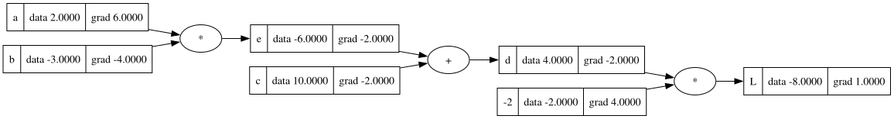
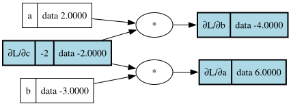
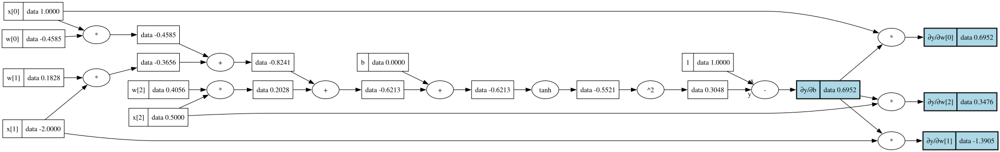
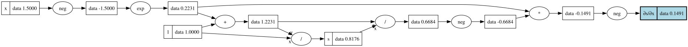
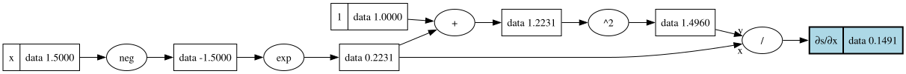
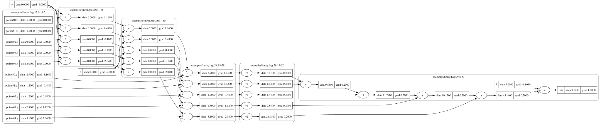

# 17 — Examples: a guided tour

Sixteen steps built `hsgrad` one module at a time. This last page uses
it: it walks through every program in `examples/`, runs the commands a
user would run, and explains what the output shows. Read it as a
tutorial for the language and the command line, and as a map back into
the module pages where each piece is explained.

| Example | Shows | § |
|---|---|---|
| `intro.hsg` | micrograd's first example: values, gradients, pictures | 1 |
| `neuron.hsg` | vectors, a function with shape variables, shared subexpressions | 2 |
| `calculus.hsg` | symbolic derivatives, second derivatives, what `--simplify` does | 3 |
| `linreg.hsg` | an inline dataset, a mean squared error, training and prediction | 4 |
| `xor.hsg` | a small neural network, parameter files | 5 |
| `moons.hsg` | micrograd's full demo: a CSV dataset, an MLP, mini-batches | 6 |
| `errors.hsg` | a broken program and the diagnostics it gets | 7 |

Every transcript on this page — a block that starts with `$ hsgrad` —
is real output, and the test suite keeps it that way: it runs each
command and compares what it prints, stdout and stderr together as a
terminal shows them, with the block (§8). The commands are run from
the repository's root directory, with `hsgrad` on the `PATH` (`cabal
install exe:hsgrad`); `cabal run -v0 hsgrad -- ARGS` works too.

---

## 1. `intro.hsg`: values and gradients

micrograd's README starts with a few scalars and a chain of operations:

```
-- Scalar expression; used to explore derivatives.
input a : Real = 2.0
input b : Real = -3.0
input c : Real = 10.0

let e = a * b
let d = e + c
let L = d * -2.0
```

`input`s are values given from outside, with defaults; `let`s name
expressions. `check` parses and checks the file and says what it found:
every declaration with its type, and the size of the graph it compiles
to (`15-compile.md`).

```
$ hsgrad check examples/intro.hsg
input a : Real
input b : Real
input c : Real
let e : Real
let d : Real
let L : Real
examples/intro.hsg: ok, 7 nodes
```

Seven nodes: three inputs, the constant `-2`, and three operations.
`eval` computes the lets (`05-core-eval.md`), and `--set` overrides an
input's default:

```
$ hsgrad eval examples/intro.hsg
e = -6
d = 4
L = -8
$ hsgrad eval examples/intro.hsg --set a=3 --show L
L = -2
```

`derive` differentiates. The derivatives are computed **symbolically**
(`08-core-symbolic.md`): reverse-mode differentiation that builds the
gradient as new graph nodes, printed as formulas (`09-core-simplify.md`),
each with its value at the current inputs. `--wrt` may name any value,
not only inputs: `∂L/∂d` is the gradient that backprop passes through
`d`.

```
$ hsgrad derive examples/intro.hsg --of L --wrt a,b,c,d,e
∂L/∂a = -2·b  = 6
∂L/∂b = -2·a  = -4
∂L/∂c = -2    = -2
∂L/∂d = -2    = -2
∂L/∂e = -2    = -2
```

These are the numbers in micrograd's `draw_dot` picture, and `plot`
draws it (`07-viz-dot.md`): every node with its value (`data`) and the
gradient of `L` with respect to it (`grad`).

```
$ hsgrad plot examples/intro.hsg --of L --dot intro.dot
wrote intro.dot
```

```
dot -Tsvg intro.dot -o intro.svg
```



`derive --dot` draws the gradients instead: the part of the forward
graph they use, the new nodes, and each gradient highlighted with its
name. `∂L/∂a` is one new node, `-2·b`; `∂L/∂c` *is* the constant `-2` of
the source, no new node at all.

```
$ hsgrad derive examples/intro.hsg --of L --wrt a,b,c --dot intro-gradient.dot
∂L/∂a = -2·b  = 6
∂L/∂b = -2·a  = -4
∂L/∂c = -2    = -2
wrote intro-gradient.dot
```



## 2. `neuron.hsg`: vectors and shared work

```
input x : Vec 3 = [1.0, -2.0, 0.5]
param w : Vec 3 ~ uniform(-1, 1)
param b : Real  = 0

fn neuron(w : Vec n, b : Real, x : Vec n) : Real =
  tanh(dot(w, x) + b)

let y = neuron(w, b, x)
```

A `param` is a value to train; `~ uniform(-1, 1)` draws it at random,
from `--seed` (1337 by default, micrograd's). `neuron` works for vectors
of any length `n`: the checker matches `n` at each call, like a C++
template (decision D8 of `00-architecture.md`), and `check` lists the
shapes it was used at.

```
$ hsgrad check examples/neuron.hsg
input x : Vec 3
param w : Vec 3
param b : Real
fn neuron(w : Vec n, b : Real, x : Vec n) : Real
  at Vec 3, Real, Vec 3 → Real
let y : Real
examples/neuron.hsg: ok, 14 nodes
$ hsgrad eval examples/neuron.hsg --seed 7 --show w --show y
w = [-0.39138865082202234, 0.4585608067689876, -0.9706574341785426]
y = -0.946164252327894
```

The core is scalar: `Vec 3` becomes three leaves `w[0]`, `w[1]`, `w[2]`,
and `--wrt w` asks for all three (`16-cli.md` §2.4). The derivative of
`tanh(z)` is `1 - tanh(z)²`, which all four gradients need. It is
computed once, and the printer names it `t1`:

```
$ hsgrad derive examples/neuron.hsg --of y --wrt w,b --simplify --dot neuron-gradient.dot
∂y/∂w[0] = x[0]·t1  = 0.6952308208745206
∂y/∂w[1] = x[1]·t1  = -1.3904616417490412
∂y/∂w[2] = x[2]·t1  = 0.3476154104372603
∂y/∂b    = t1       = 0.6952308208745206
where
  t1 = 1 - tanh(x[0]·w[0] + x[1]·w[1] + x[2]·w[2] + b)²
wrote neuron-gradient.dot
```

In the picture the sharing is a node with three outgoing edges, `∂y/∂b`.
This is why symbolic differentiation here costs no more than backprop:
the gradient graph shares subexpressions with itself and with the
forward graph (D6).



## 3. `calculus.hsg`: derivatives to explore

`calculus.hsg` is a playground for `derive`: a polynomial, `sigmoid`, and
an expression that is simpler than it looks.

```
input x : Real = 1.5

let cube = x ^ 3
let dcube = 3 * x ^ 2

let s  = sigmoid(x)
let ds = s * (1 - s)

let p = (x + 1) * (x + 1) - x * x
```

```
$ hsgrad eval examples/calculus.hsg
cube  = 3.375
dcube = 6.75
s     = 0.8175744761936437
ds    = 0.14914645207033286
p     = 4
```

### 3.1 Second derivatives

`derive` differentiates once: its `--of` is a value of the program. For
a second derivative, write the first one down as a `let` and
differentiate that. `dcube` is the textbook derivative of `cube`, and
`derive` agrees with it (both are 6.75); differentiating `dcube` gives
the second derivative, `6·x`:

```
$ hsgrad derive examples/calculus.hsg --of cube --wrt x
∂cube/∂x = 3·x²  = 6.75
$ hsgrad derive examples/calculus.hsg --of dcube --wrt x
∂dcube/∂x = 3·(2·x)  = 9
$ hsgrad derive examples/calculus.hsg --of dcube --wrt x --simplify
∂dcube/∂x = 6·x  = 9
```

(The core can differentiate a gradient graph again — step 7's
`backwardNodes` works on any node — but the command line has no option
for it yet; see §9.)

### 3.2 What `--simplify` does

`sigmoid(x)` is not an operation of the core; the compiler writes it as
`1 / (1 + exp(-x))` (`01-language.md` §6). Its gradient, straight from
the reverse sweep, is the chain rule applied step by step: a `neg` for
`-x`, the derivative of `/`, `exp`'s own value reused:

```
$ hsgrad derive examples/calculus.hsg --of s --wrt x --dot sigmoid-gradient.dot
∂s/∂x = -(-(1/t1/t1)·exp(-x))  = 0.14914645207033284
where
  t1 = 1 + exp(-x)
wrote sigmoid-gradient.dot
```



`--simplify` rewrites it into a canonical form (`09-core-simplify.md`):
the two negations cancel, `1/t1/t1` becomes `t1⁻²`, and the result is
rebuilt with sharing:

```
$ hsgrad derive examples/calculus.hsg --of s --wrt x --simplify --dot sigmoid-gradient-simplified.dot
∂s/∂x = exp(-x)/(1 + exp(-x))²  = 0.14914645207033284
wrote sigmoid-gradient-simplified.dot
```



That is the derivative of sigmoid in the form calculus gives first. The
form everyone remembers, `s·(1 - s)`, is `ds` in the file. Its value
above is `0.14914645207033286`, which differs from the gradient's in the
last digit: the same number computed along a different path, rounded
differently. `ds` differentiated gives the second derivative of sigmoid,
`s'·(1 - 2·s)`:

```
$ hsgrad derive examples/calculus.hsg --of ds --wrt x --simplify
∂ds/∂x = exp(-x)·(1 - 2/t1)/t1²  = -0.09473021278475265
where
  t1 = 1 + exp(-x)
```

The simplifier gathers like terms and folds constants, but it does not
multiply out products of sums (D7), so it doesn't always find the
shortest form. Where like terms are all there is, it finds everything:
`p = (x + 1)² - x²` is `2·x + 1` in disguise.

```
$ hsgrad derive examples/calculus.hsg --of p --wrt x
∂p/∂x = -x + (-x) + (x + 1 + (x + 1))  = 2
$ hsgrad derive examples/calculus.hsg --of p --wrt x --simplify
∂p/∂x = 2  = 2
```

A value that `p` doesn't depend on has derivative 0:

```
$ hsgrad derive examples/calculus.hsg --of p --wrt cube
∂p/∂cube = 0  = 0
```

## 4. `linreg.hsg`: a dataset, a loss, training

The smallest learning problem: fit a line to five points.

```
data points : { x : Real, y : Real } = rows [
  (-2, -2.9),
  (-1, -1.2),
  ( 0,  1.2),
  ( 1,  2.8),
  ( 2,  5.1)
]

param w : Real = 0
param b : Real = 0

model line(x : Real) : Real = w * x + b

loss = mean [ (line(x) - y) ^ 2 | (x, y) <- points ]
```

- `data` declares a dataset with a schema; `rows` gives it inline
  (`14-data.md`).
- `model` is the function that `predict` calls; it needs concrete types.
- `loss` is what `train` minimises: here the mean squared error, a
  comprehension over the dataset reduced by `mean`.

The points lie near `y = 2·x + 1`, and the noise was chosen so that the
least-squares line is exactly `w = 2`, `b = 1`: we know the answer. The
graph has a copy of the loss term for every row of the dataset, each
reading its row from input leaves (`points#0.x`, …), the **slots** of
decision D10. With `--cluster`, `plot` groups the scalar nodes by the
source expression they came from:

```
$ hsgrad check examples/linreg.hsg
data points : { x : Real, y : Real }
param w : Real
param b : Real
model line : Real → Real
loss : Real
examples/linreg.hsg: ok, 38 nodes
$ hsgrad plot examples/linreg.hsg --of loss --cluster --dot linreg-loss.dot
wrote linreg-loss.dot
```



The gradients of the loss are the sums over the rows that the textbook
derives by hand, `∂/∂w = Σ 2·(w·x + b - y)·x / 5`:

```
$ hsgrad derive examples/linreg.hsg --of loss --wrt w,b
∂loss/∂w = t1·points#4.x + t2·points#3.x + t3·points#2.x + t4·points#1.x + t5·points#0.x  = -8
∂loss/∂b = t1 + t2 + t3 + t4 + t5  = -2
where
  t1 = 5⁻¹·(2·(w·points#4.x + b - points#4.y))
  t2 = 5⁻¹·(2·(w·points#3.x + b - points#3.y))
  t3 = 5⁻¹·(2·(w·points#2.x + b - points#2.y))
  t4 = 5⁻¹·(2·(w·points#1.x + b - points#1.y))
  t5 = 5⁻¹·(2·(w·points#0.x + b - points#0.y))
```

`train` runs gradient descent (`10-train.md`): 100 steps at rate 0.1 by
default, a report every 10 steps (here 20). `--save-params` writes the
result as a small `.hsg` file of `param` declarations (`16-cli.md`
§2.5), which `eval` and `predict` read with `--params`:

```
$ hsgrad train examples/linreg.hsg --report-every 20 --save-params linreg.params
train examples/linreg.hsg: 100 steps, lr 0.1 (constant), seed 1337, points: 5 of 5 rows per step
step  0  loss 9.028        accuracy 40%
step 20  loss 0.0281329    accuracy 100%
step 40  loss 0.028        accuracy 100%
step 60  loss 0.028        accuracy 100%
step 80  loss 0.028        accuracy 100%
step 99  loss 0.028        accuracy 100%
wrote linreg.params
$ hsgrad eval examples/linreg.hsg --params linreg.params --show w --show b --show loss
w    = 1.9999999999999998
b    = 0.9999999997962964
loss = 0.028000000000000004
$ hsgrad predict examples/linreg.hsg --params linreg.params --set x=10
line(10) = 20.999999999796295
```

Training found the line, and the loss stops at 0.028, the mean of the
squared noise: no line does better. Two things to notice:

- The `accuracy` column is the **sign accuracy**: how often
  `line(x)` has the sign of `y`. It is meant for classifiers with
  labels ±1 (§5, §6) and means little for a regression; `train` shows
  it whenever the model's result is compared with a `Real` label
  (`01-language.md` §11).
- The rate matters. This loss is a quadratic whose curvature is 4 in
  the direction of `w` (twice the mean of `x²`), and gradient descent on
  a quadratic diverges when the rate is above 2 / curvature = 0.5. At
  0.6 every step overshoots further:

```
$ hsgrad train examples/linreg.hsg --lr 0.6 --steps 20 --report-every 5
train examples/linreg.hsg: 20 steps, lr 0.6 (constant), seed 1337, points: 5 of 5 rows per step
step  0  loss 9.028        accuracy 40%
step  5  loss 231.432      accuracy 100%
step 10  loss 6693.49      accuracy 20%
step 15  loss 193611       accuracy 100%
step 19  loss 2857300      accuracy 100%
```

## 5. `xor.hsg`: a neural network

XOR is the classic problem that no line solves. `xor.hsg` has a hidden
layer of four `tanh` units, written with a matrix product `@`:

```
data xor : { x : Vec 2, y : Real } = rows [
  ([0, 0], -1),
  ([0, 1],  1),
  ([1, 0],  1),
  ([1, 1], -1)
]

param W1 : Mat 4 2 ~ uniform(-1, 1)
param b1 : Vec 4   = 0
param w2 : Vec 4   ~ uniform(-1, 1)
param b2 : Real    = 0

model net(x : Vec 2) : Real =
  dot(w2, tanh(W1 @ x + b1)) + b2

loss = mean [ (net(x) - y) ^ 2 | (x, y) <- xor ]
```

```
$ hsgrad check examples/xor.hsg
data xor : { x : Vec 2, y : Real }
param W1 : Mat 4 2
param b1 : Vec 4
param w2 : Vec 4
param b2 : Real
model net : Vec 2 → Real
loss : Real
examples/xor.hsg: ok, 154 nodes
```

Here the labels are ±1, and the sign accuracy is the right measure:
after 50 steps every row is on the right side, and the loss keeps
falling as the outputs approach ±1.

```
$ hsgrad train examples/xor.hsg --steps 200 --seed 1 --report-every 50 --save-params xor.params
train examples/xor.hsg: 200 steps, lr 0.1 (constant), seed 1, xor: 4 of 4 rows per step
step   0  loss 1.22558      accuracy 50%
step  50  loss 0.543008     accuracy 100%
step 100  loss 0.0432655    accuracy 100%
step 150  loss 0.000801179  accuracy 100%
step 199  loss 1.22675e-5   accuracy 100%
wrote xor.params
$ hsgrad predict examples/xor.hsg --params xor.params --set "x=[0, 1]"
net([0, 1]) = 0.9963848175526087
$ hsgrad predict examples/xor.hsg --params xor.params --set "x=[1, 1]"
net([1, 1]) = -0.9954410498241719
```

The parameter file is readable, and could be pasted into `xor.hsg` in
place of the random initialisers:

```
-- Parameters of examples/xor.hsg, saved by `hsgrad train`.
-- train examples/xor.hsg: 200 steps, lr 0.1 (constant), seed 1, xor: 4 of 4 rows per step
-- last step 199 loss 1.22675e-5 accuracy 100%
param W1 : Mat 4 2 = [
  [1.565136577214541, -0.7738212582684185],
  [1.3753745646130369, 1.5741263538315122],
  [-0.19142568511824803, -0.4067464023639376],
  [1.2994860916889452, -1.8474781008125076]
]
param b1 : Vec 4   = [0.22869202081909057, -0.05370492873825431, 0.16877987956341362, -0.682371006080259]
param w2 : Vec 4   = [-1.7449438930150662, 1.7918077820789862, 0.9325426444406195, 1.5596239477396878]
param b2 : Real    = 0.2588148707269265
```

A parameter file must fit the program: `xor.hsg` with the parameters
of `linreg.hsg` is reported parameter by parameter (E0505), in both
files:

```
$ hsgrad train examples/linreg.hsg --report-every 100 --save-params linreg.params
train examples/linreg.hsg: 100 steps, lr 0.1 (constant), seed 1337, points: 5 of 5 rows per step
step  0  loss 9.028        accuracy 40%
step 99  loss 0.028        accuracy 100%
wrote linreg.params
$ hsgrad predict examples/xor.hsg --params linreg.params --set "x=[0, 1]"
error[E0505]: parameter `W1` is missing from `linreg.params`
 --> examples/xor.hsg:8:7
  |
8 | param W1 : Mat 4 2 ~ uniform(-1, 1)
  |       ^^ has no value in the parameter file
  |
  = hint: a parameter file needs a value for every parameter of the program

error[E0505]: parameter `b1` is missing from `linreg.params`
 --> examples/xor.hsg:9:7
  |
9 | param b1 : Vec 4   = 0
  |       ^^ has no value in the parameter file
  |
  = hint: a parameter file needs a value for every parameter of the program

error[E0505]: parameter `w2` is missing from `linreg.params`
  --> examples/xor.hsg:10:7
   |
10 | param w2 : Vec 4   ~ uniform(-1, 1)
   |       ^^ has no value in the parameter file
   |
   = hint: a parameter file needs a value for every parameter of the program

error[E0505]: parameter `b2` is missing from `linreg.params`
  --> examples/xor.hsg:11:7
   |
11 | param b2 : Real    = 0
   |       ^^ has no value in the parameter file
   |
   = hint: a parameter file needs a value for every parameter of the program

error[E0505]: the program has no parameter `w`
 --> linreg.params:4:7
  |
4 | param w : Real = 1.9999999999999998
  |       ^ unknown parameter

error[E0505]: the program has no parameter `b`
 --> linreg.params:5:7
  |
5 | param b : Real = 0.9999999997962964
  |       ^ unknown parameter

6 errors
```

## 6. `moons.hsg`: micrograd's demo

micrograd's demo notebook trains a 2-16-16-1 multilayer perceptron with
ReLU units to separate two interleaved half-moons. `moons.hsg` is the
same network, loss and data:

```
data moons : { x : Vec 2, y : Real } =
  csv "data/moons.csv" { x = [x1, x2], y = label }

param W1 : Mat 16 2  ~ uniform(-1, 1)
param b1 : Vec 16    = 0
param W2 : Mat 16 16 ~ uniform(-1, 1)
param b2 : Vec 16    = 0
param W3 : Mat 1 16  ~ uniform(-1, 1)
param b3 : Vec 1     = 0

fn layer(W : Mat m n, b : Vec m, x : Vec n) : Vec m = W @ x + b

model mlp(x : Vec 2) : Real =
  let h1 = relu(layer(W1, b1, x))  in
  let h2 = relu(layer(W2, b2, h1)) in
  layer(W3, b3, h2)[0]

-- SVM max-margin loss + L2 regularisation
loss =
  let data_loss = mean [ relu(1 - y * mlp(x)) | (x, y) <- moons ] in
  let reg       = 1e-4 * sum [ sum(p ^ 2) | p <- params ] in
  data_loss + reg
```

- The data comes from `examples/data/moons.csv` (paths are relative to
  the `.hsg` file), 100 points made like scikit-learn's `make_moons`
  by `scripts/MakeMoons.hs`, with labels ±1.
- `layer` is generic; `check` shows its three instances.
- The loss is micrograd's: a hinge loss `relu(1 - y·score)`, which is
  zero for points classified with a margin, plus L2 regularisation over
  `params`, every parameter of the file.

```
$ hsgrad check examples/moons.hsg
data moons : { x : Vec 2, y : Real }
param W1 : Mat 16 2
param b1 : Vec 16
param W2 : Mat 16 16
param b2 : Vec 16
param W3 : Mat 1 16
param b3 : Vec 1
fn layer(W : Mat m n, b : Vec m, x : Vec n) : Vec m
  at Mat 1 16, Vec 1, Vec 16 → Vec 1
  at Mat 16 2, Vec 16, Vec 2 → Vec 16
  at Mat 16 16, Vec 16, Vec 16 → Vec 16
model mlp : Vec 2 → Real
loss : Real
examples/moons.hsg: ok, 65715 nodes
```

65,715 scalar nodes: the network is unrolled once per row of the batch
(`15-compile.md` §5.1). This is the price of a scalar core (D5), and the
reason a tensor backend is the first item of §9. micrograd's settings —
100 steps, a rate falling linearly from 1.0 to 0.1, the full batch —
separate the moons completely. It takes about 10 seconds:

<!-- slow -->
```
$ hsgrad train examples/moons.hsg --steps 100 --lr 1.0 --lr-schedule linear:0.1
train examples/moons.hsg: 100 steps, lr 1 (linear to 0.1), seed 1337, moons: 100 of 100 rows per step
step  0  loss 0.858769     accuracy 63%     lr 1
step 10  loss 0.26799      accuracy 90%     lr 0.91
step 20  loss 0.276071     accuracy 90%     lr 0.82
step 30  loss 0.0683658    accuracy 99%     lr 0.73
step 40  loss 0.0781449    accuracy 97%     lr 0.64
step 50  loss 0.0314549    accuracy 99%     lr 0.55
step 60  loss 0.0270361    accuracy 100%    lr 0.46
step 70  loss 0.0238252    accuracy 100%    lr 0.37
step 80  loss 0.021905     accuracy 100%    lr 0.28
step 90  loss 0.0211429    accuracy 100%    lr 0.19
step 99  loss 0.0202695    accuracy 100%    lr 0.109
```

The test suite checks the bar of `00-architecture.md` §7, at least 95%,
with a third of the steps, which takes about 3 seconds:

<!-- slow -->
```
$ hsgrad train examples/moons.hsg --steps 30 --lr 1 --lr-schedule linear:0.1
train examples/moons.hsg: 30 steps, lr 1 (linear to 0.1), seed 1337, moons: 100 of 100 rows per step
step  0  loss 0.858769     accuracy 63%     lr 1
step 10  loss 0.253493     accuracy 91%     lr 0.7
step 20  loss 0.145698     accuracy 96%     lr 0.4
step 29  loss 0.107856     accuracy 97%     lr 0.13
```

With `--batch N`, each step uses `N` rows drawn at random (from
`--seed`), and the graph has only `N` copies of the network. Steps are
cheaper and noisier; the reported loss and accuracy are those of the
step's batch:

```
$ hsgrad train examples/moons.hsg --steps 5 --batch 10 --report-every 1
train examples/moons.hsg: 5 steps, lr 0.1 (constant), seed 1337, moons: 10 of 100 rows per step
step 0  loss 0.652608     accuracy 70%
step 1  loss 0.592356     accuracy 80%
step 2  loss 0.647015     accuracy 90%
step 3  loss 0.598281     accuracy 80%
step 4  loss 0.458872     accuracy 90%
```

A batch can't be larger than the dataset:

```
$ hsgrad train examples/moons.hsg --batch 200
error[E0405]: `--batch 200` is larger than dataset `moons`
 --> examples/moons.hsg:1:6
  |
1 | data moons : { x : Vec 2, y : Real } =
  |      ^^^^^ `moons` has 100 rows
  |
  = hint: use `--batch 100` or less, or leave `--batch` out to use every row in every step

1 error
```

## 7. `errors.hsg`: diagnostics

The last example is broken on purpose. It parses, so the checker sees
all of it (`13-checker.md`):

```
input x : Vec 2 = [1, -1]

param W1 : Mat 4 3 ~ uniform(-1, 1)   -- should be Mat 4 2: x has 2 elements
param b1 : Vec 4   = 0
param w2 : Vec 4   ~ uniform(-1, 1)
param scale : Real = 1                -- never used

fn affine(W : Mat m n, b : Vec m, v : Vec n) : Vec m = W @ v + b

let h = tahn(affine(W1, b1, x))

let g = 2 * h

let y = w2 @ b1

let z : Real = b1 * 2
```

(The file itself has comments between the declarations, so its line
numbers are those of the output.)

```
$ hsgrad check examples/errors.hsg
warning[W0202]: `scale` is never used
  --> examples/errors.hsg:15:7
   |
15 | param scale : Real = 1                -- never used
   |       ^^^^^

error[E0201]: undefined name `tahn`
  --> examples/errors.hsg:21:9
   |
21 | let h = tahn(affine(W1, b1, x))
   |         ^^^^ not defined
   |
   = hint: did you mean `tanh`?

error[E0303]: shape variable `n` bound inconsistently
  --> examples/errors.hsg:21:29
   |
17 | fn affine(W : Mat m n, b : Vec m, v : Vec n) : Vec m = W @ v + b
   |               -------                 ----- both parameters use `n`
...
21 | let h = tahn(affine(W1, b1, x))
   |                     --      ^ `Vec 2`, so `n = 2` here
   |                     |
   |                     `Mat 4 3`, so `n = 3` here

error[E0302]: shape mismatch in matrix product
  --> examples/errors.hsg:28:9
   |
28 | let y = w2 @ b1
   |         ^^^^^^^ `Vec 4 @ Vec 4`
   |
   = hint: for the inner product of two vectors write `dot(u, v)`

error[E0308]: value doesn't match the `let` annotation
  --> examples/errors.hsg:31:16
   |
31 | let z : Real = b1 * 2
   |         ----   ^^^^^^ this is `Vec 4`
   |         |
   |         expected `Real` because of this
   |
   = hint: use `sum(…)`, `dot(…)` or an index `[i]` to get a `Real`

4 errors, 1 warning
```

What to notice (`11-diagnostics.md`, `13-checker.md`):

- **All** independent problems in one run, sorted by position, then a
  summary. The program exits with code 1.
- Two problems in one line are two diagnostics: the typo and the shape
  variable don't depend on each other.
- E0303 points at four places in two lines: where `n` is used twice in
  the signature, and the two arguments that bind it differently.
- `let g = 2 * h` gets no error: `h` is broken, so it is "poisoned", and
  nothing that uses it is reported again. One mistake, one message.
- Hints suggest the fix: the nearest name by edit distance, `dot` for a
  product of vectors.

The command line gets the same treatment, because to the driver it is a
small source file (`16-cli.md` §1.6):

```
$ hsgrad derive examples/intro.hsg --of Lx --wrt a,q
error[E0201]: no value named `Lx` in `examples/intro.hsg`
 --> <command line>:1:39
  |
1 | hsgrad derive examples/intro.hsg --of Lx --wrt a,q
  |                                       ^^ unknown name
  |
  = note: values are inputs, parameters, top-level `let`s and `loss`
  = hint: did you mean `L`?

error[E0201]: no value named `q` in `examples/intro.hsg`
 --> <command line>:1:50
  |
1 | hsgrad derive examples/intro.hsg --of Lx --wrt a,q
  |                                                  ^ unknown name
  |
  = note: values are inputs, parameters, top-level `let`s and `loss`

2 errors
$ hsgrad eval examples/neuron.hsg --set "x=[1, 2]"
error[E0503]: the value for input `x` has the wrong shape
 --> <command line>:1:41
  |
1 | hsgrad eval examples/neuron.hsg --set x=[1, 2]
  |                                         ^^^^^^ a `Vec 2`
  |
 ::: examples/neuron.hsg:1:7
  |
1 | input x : Vec 3 = [1.0, -2.0, 0.5]
  |       - declared as a `Vec 3` here
  |
  = hint: write a `Vec 3`, like `x=[1, 2, 3]`

1 error
$ hsgrad train examples/intro.hsg
error[E0201]: `examples/intro.hsg` has no `loss`
 --> <command line>:1:8
  |
1 | hsgrad train examples/intro.hsg
  |        ^^^^^ needs a `loss` declaration
  |
  = note: `train` minimises the `loss`

1 error
```

(The command line in the snippet is re-assembled from the arguments,
after the shell removed the quotes.)

And so do numbers that go wrong at runtime: the graph remembers which
source expression made each node (D4), so a non-finite value is
reported there, with the computation that produced it.
`sigmoid(-1000)` computes `exp(1000)` on the way:

```
$ hsgrad eval examples/calculus.hsg --set x=-1000 --show s
error[E0501]: non-finite value: `exp` overflows
  --> examples/calculus.hsg:15:10
   |
15 | let s  = sigmoid(x)
   |          ^^^^^^^^^^ `exp(1000)` is ∞
   |
   = hint: `exp(x)` is too large for a Double when x is above about 709.78

1 error
```

## 8. The tests behind this page

`test/HsGrad/EndToEndSpec.hs` runs the built `hsgrad` program as a
process, the way a user does. The tests of step 15 (`DriverSpec`)
already run every command in-process, with the real command-line parser
and the driver's `execute`; what only a process shows is the shell
around them, `app/Main.hs`: exit codes, results on stdout and
diagnostics on stderr, files written to disk, UTF-8 output whatever
the locale (the tests run the program with `LC_ALL=C`). The test suite
declares

```cabal
build-tool-depends: hsgrad:hsgrad
```

so cabal builds the program before the tests and puts it on their
`PATH`.

The tests:

- **Every example** but `errors.hsg` checks with no diagnostic at all,
  not even a warning. The list comes from the directory, so a new
  example is covered without touching the tests.
- `errors.hsg` exits with 1, prints nothing on stdout, and gives
  exactly W0202, E0201, E0303, E0302, E0308.
- `moons.hsg` trains to at least 95% accuracy (§6, 30 steps); `xor.hsg`
  to 100%, and `predict` with the saved file gives every row the sign
  of its label; `linreg.hsg` finds `w = 2`, `b = 1`, and predicts 21 at
  `x = 10`.
- `derive` of `intro.hsg` prints `01-language.md` §1.1; `derive --dot`
  of `neuron.hsg`, simplified and not, writes DOT that Graphviz
  accepts, identical to `--format dot`; `plot --dot -` prints DOT on
  stdout. (Without Graphviz installed, the Graphviz checks are pending,
  not failing.)
- The derivatives written down in `calculus.hsg` agree with `derive`.
- Exit code 1 for a command line that doesn't parse and for an error at
  runtime.
- **This page.** Every block that starts with `$ hsgrad` is a
  transcript: lines starting with `$ ` are commands, the lines up to the
  next command are what it prints. The test runs each block in a fresh
  temporary directory (with a link to `examples/`, so that paths and
  written files look as they do here) and compares the output, stdout
  and stderr in one pipe as a terminal shows them, line by line. A test
  also checks that every example appears in some transcript.

A block preceded by the line `<!-- slow -->` (an HTML comment, invisible
on a rendered page) is skipped unless `HSGRAD_SLOW` is set: the two full
batch moons runs of §6 are, the 10-second one and the 30-step one that
the explicit moons test already runs.

```bash
HSGRAD_SLOW=1 cabal test
```

Testing the tests, as in earlier steps: deliberate bugs, each tried on
its own. None of the three bugs in `app/Main.hs` is visible to the
in-process tests of step 15; each makes this suite fail.

| Bug | Caught by |
|---|---|
| a number changed in an output line of this page | the transcript test of that block |
| `Main` doesn't set UTF-8 on stdout and stderr | every test whose output has `∂` or `·` (the C locale) |
| `Main` exits with 0 after errors | the `errors.hsg` and exit-code tests |
| "wrote FILE" on stdout instead of stderr | the `xor.hsg` and `derive --dot` tests |

Without it, the end-to-end tests take about 4 seconds, most of it the
30-step moons run; the whole suite about 8.

## 9. Where to go from here

The project is complete as planned in `00-architecture.md` §9. What it
deliberately leaves out, and what would come next, is collected in
`00-architecture.md` §10. The most instructive next steps:

- **A tensor backend.** The scalar core unrolls `moons.hsg` into 65,715
  nodes per step. Ops on whole vectors and matrices, with their own
  derivative rules, would make it a few dozen, without changing the
  language (D5).
- **Better optimisers.** Momentum and Adam need state per parameter
  across steps; `Train.Optim` has room for them next to SGD.
- **Higher derivatives from the command line.** The core can already
  differentiate a gradient graph (§3.1); `derive` would need a way to
  ask for it.

All pages, in reading order, are listed in [`README.md`](README.md)
(the one in `docs/`).
